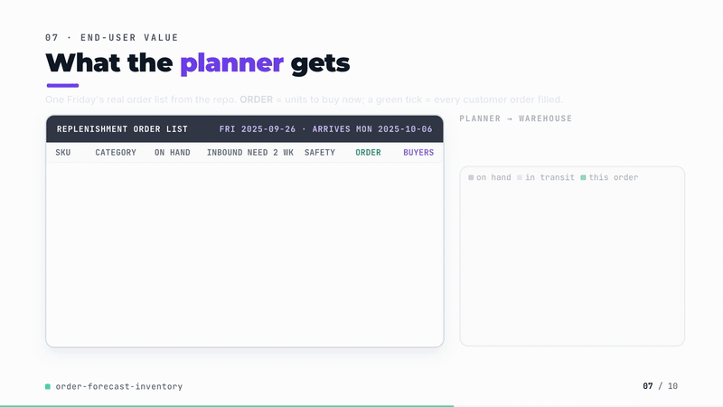
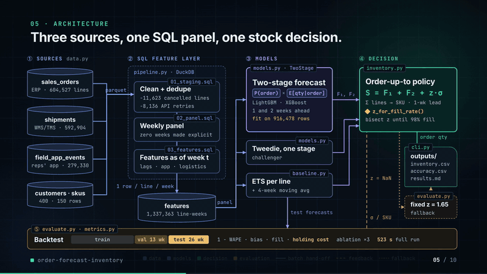

# order-forecast-inventory

[](https://github.com/kavya2693/order-forecast-inventory/actions/workflows/ci.yml)


Weekly order forecasts for every customer x SKU line of a B2B distributor, built by joining
shipments, the field-sales app and sales orders in SQL, and judged by how much stock they let
the warehouse hold at the same fill rate.

[](https://kavya2693.github.io/work-demos/order-forecast-inventory.mp4)

*86-second silent walkthrough. [Play the full video](https://kavya2693.github.io/work-demos/order-forecast-inventory.mp4) · [download the MP4, 5.6 MB](docs/demo/demo.mp4).*

📄 **Audit report:** every figure and assumption in the video, traced to its source — [PDF](docs/demo/AUDIT_REPORT.pdf) · [Word](docs/demo/AUDIT_REPORT.docx) · [Markdown](docs/demo/AUDIT_REPORT.md)

## At a glance

| | |
|---|---|
| **Problem** | A distributor's planner orders 150 SKUs for 400 retail customers every Friday from a smoothed history of each customer's orders. Quote requests in the reps' app and short shipments in the warehouse system never reach that forecast, so the gap is covered with safety stock at a 25% annual carrying cost. |
| **Approach** | Three DuckDB SQL stages join orders, shipments and app events into a weekly customer x SKU panel with explicit zero weeks and leak-free features. LightGBM and XGBoost two-stage models (P(order) x E[qty given an order]) forecast each line one and two weeks ahead. Every forecaster feeds the same SKU-level order-up-to policy, and the deciding number is holding cost at a matched 98% fill rate. |
| **Result** | Holding cost at 98% fill falls **48.7%** against per-line ETS (242,371 to 124,338 a year, XGBoost two-stage). SKU-level 1 - WAPE **0.81 vs 0.70**. "Will this line order next week" ROC-AUC **0.830 vs 0.582**. The field app carries almost all the lift (line accuracy 0.028 history only, 0.113 with the app). |
| **What didn't win** | The two-stage split ties a single Tweedie LightGBM (123,907 vs 129,047 a year at 98% fill). Line-level accuracy is 0.12 one week ahead and below zero two weeks ahead for every method. The model with the best line-level accuracy (the "point" variant, 0.214) is the worst boosted model on stock. Logistics features add 0.008. |

## Architecture

```mermaid
flowchart LR
    subgraph SRC["Sources"]
        GEN["Seeded generator<br/>scripts/generate_data.py<br/>data.py"]
        SO[("sales_orders.parquet<br/>ERP order lines")]
        SH[("shipments.parquet<br/>warehouse and transport")]
        EV[("field_app_events.parquet<br/>reps' app API log")]
        DIM[("customers.parquet · skus.parquet")]
    end

    subgraph FEAT["Data and features (DuckDB)"]
        CON["raw_* views<br/>pipeline.connect"]
        STG["Cleaning and dedupe<br/>sql/01_staging.sql"]
        PAN[("panel: customer x SKU x week<br/>sql/02_panel.sql")]
        FTR[("features + targets y_h1, y_h2<br/>sql/03_features.sql")]
    end

    subgraph MOD["Models"]
        ETS["ETS(A,N,N) per line<br/>baseline.ets_forecasts"]
        MA["4-week moving average<br/>qty_mean_4w feature"]
        TS["Two-stage P(order) x E[qty]<br/>LightGBM and XGBoost<br/>models.TwoStage"]
        TW["Single-stage Tweedie<br/>models.SingleStage"]
        PT["Point variant: zero unless P at least 0.5<br/>evaluate.fit_predict"]
    end

    subgraph DEC["Decision: order-up-to policy"]
        AGG["Sum lines to SKU, h=1 and h=2<br/>evaluate._sku_matrix"]
        SIG["Safety stock sigma per forecaster<br/>13 validation weeks<br/>evaluate.inventory_table"]
        SIM["Weekly order-up-to, lost sales<br/>inventory.simulate"]
        ZB["z for 98% fill, bisection<br/>inventory.z_for_fill_rate"]
    end

    subgraph EVAL["Evaluation"]
        ACC["1 - WAPE and bias, line and SKU<br/>metrics.py · evaluate.accuracy_table"]
        ABL["Source ablation<br/>evaluate.ablation_table"]
        AUC["Order-occurrence ROC-AUC<br/>evaluate.auc_table"]
        NEW["Lines first ordered in test window<br/>invisible to every forecaster"]
    end

    subgraph OUT["Outputs"]
        REP[("outputs/<br/>inventory.csv · accuracy.csv · ablation.csv<br/>order_auc.csv · metrics.json")]
        MD["Run report<br/>report.write_report"]
    end

    GEN --> SO & SH & EV & DIM
    SO --> CON
    SH --> CON
    EV --> CON
    DIM --> CON
    CON -->|"raw_ views"| STG
    STG -->|"stg_orders, stg_events, stg_shipments"| PAN
    PAN -->|"weekly qty, quotes, visits, short ships"| FTR
    FTR -->|"qty history"| ETS
    FTR -->|"qty_mean_4w"| MA
    FTR -->|"history + app + logistics"| TS
    FTR -->|"same feature set"| TW
    TS -->|"P(order), size"| PT
    ETS -->|"line forecasts"| AGG
    MA -->|"line forecasts"| AGG
    TS -->|"line forecasts"| AGG
    TW -->|"line forecasts"| AGG
    PT -->|"line forecasts"| AGG
    AGG -->|"F1, F2 per SKU-week"| SIM
    SIG -->|"sigma per SKU"| SIM
    SIM -->|"fill rate"| ZB
    ZB -.->|"next z until fill reaches 98%"| SIM
    AGG -.->|"validation-window error feeds back"| SIG
    NEW -.->|"demand still hits stock"| SIM
    EV -.->|"outage weeks arrive as zero events"| STG
    GEN -.->|"regenerated when data/raw is empty"| CON
    TS --> ACC & ABL & AUC
    ETS --> ACC
    SIM -->|"fill rate, holding cost"| REP
    ACC --> REP
    ABL --> REP
    AUC --> REP
    REP --> MD

    classDef data fill:#7fa8ff,stroke:#3d6fd9,color:#0b1020
    classDef model fill:#b9a2ff,stroke:#7a5fd6,color:#0b1020
    classDef decision fill:#3fd8a8,stroke:#1f9c76,color:#0b1020
    classDef evaluation fill:#f2c46d,stroke:#b8902f,color:#0b1020
    classDef risk fill:#ff8a73,stroke:#cc5640,color:#0b1020

    class GEN,SO,SH,EV,DIM,CON,STG,PAN,FTR,REP,MD data
    class ETS,MA,TS,TW model
    class PT,NEW risk
    class AGG,SIG,SIM,ZB decision
    class ACC,ABL,AUC evaluation
```





Solid edges are the weekly data flow; dotted edges are the feedback and fallback paths. Red
nodes are where the result can mislead: the "point" variant is what chasing line-level WAPE
produces, and lines that start inside the test window are demand no forecaster saw.

### Components

| Component | Responsibility | File |
|---|---|---|
| Data generator | Five source tables with the causal links and the mess described under The data | [`scripts/generate_data.py`](scripts/generate_data.py), [`src/order_forecast/data.py`](src/order_forecast/data.py) |
| Scale and policy constants | `FULL` and `SMALL` scales, the 13 validation / 26 test week split, lead time, 25% holding rate, z = 1.65, 98% fill target | [`src/order_forecast/config.py`](src/order_forecast/config.py) |
| SQL pipeline | Registers the parquet files as `raw_*` views and runs staging, panel and features in DuckDB | [`src/order_forecast/pipeline.py`](src/order_forecast/pipeline.py), [`src/order_forecast/sql/`](src/order_forecast/sql/) |
| ETS baseline | ETS(A,N,N) per line, smoothing weight chosen per series on training weeks, vectorised across lines | [`src/order_forecast/baseline.py`](src/order_forecast/baseline.py) |
| Order models | Two-stage classifier x gamma regressor (LightGBM, XGBoost), single-stage Tweedie, feature groups for the ablation | [`src/order_forecast/models.py`](src/order_forecast/models.py) |
| Inventory policy | Weekly order-up-to with lost sales and a two-week warm-up; bisection for the z that reaches a target fill rate | [`src/order_forecast/inventory.py`](src/order_forecast/inventory.py) |
| Metrics | WAPE, 1 - WAPE and bias | [`src/order_forecast/metrics.py`](src/order_forecast/metrics.py) |
| Backtest | Train / validation / test split, fitting every forecaster at h=1 and h=2, accuracy, ablation, AUC and inventory tables | [`src/order_forecast/evaluate.py`](src/order_forecast/evaluate.py) |
| Orchestrator and report | One command end to end; writes `outputs/` and `results.md` | [`src/order_forecast/cli.py`](src/order_forecast/cli.py), [`src/order_forecast/report.py`](src/order_forecast/report.py) |

### Design decisions

| Decision | Options considered | Chosen | Trade-off |
|---|---|---|---|
| What picks the model | Line-level 1 - WAPE; SKU-level 1 - WAPE; inventory cost | Holding cost at a matched 98% fill rate from one shared order-up-to policy ([ADR-0001](docs/adr/0001-two-stage-model-scored-by-inventory.md)) | Judges forecasts the way the planner uses them, but adds a simulation that has to be right (tested on perfect, flat and matched-z cases) and inherits its simplifications: lost sales, one lead time, no case packs |
| Model structure | Croston / SBA; one global DeepAR-style model; single Tweedie regressor; two-stage occurrence x size | Two-stage in LightGBM and XGBoost, with single-stage Tweedie kept as the check | Croston cannot use the joined signals and DeepAR is heavier to run and explain. The two-stage split bought no accuracy over Tweedie; it stays because P(order) is something a rep can act on |
| Where the joins live | pandas in Python; SQL in a warehouse dialect | SQL in DuckDB, kept close to BigQuery Standard SQL ([mapping](docs/BIGQUERY.md)) | Runs on a laptop and in CI and moves to a warehouse with mechanical edits; the customer x SKU x week cross-join is the expensive step there and needs partitioning |
| When a shipment fact counts | The order week; the week the fact became known | Week known: short ships on `ship_date`, lateness on `delivered_date` | No leakage from the future, at the cost of a later and weaker logistics signal (it adds 0.008 line accuracy) |
| Safety stock | One textbook sigma for every method; each forecaster's own error | RMSE of each forecaster's two-week SKU sum over 13 validation weeks | A forecaster pays for its own errors, which is the point of the comparison; 13 weeks is a short window and sigma is one number per SKU, not per season |
| Backtest design | Rolling origin; one train / validation / test split | One split: training weeks, 13 validation, 26 test | Runs in about nine minutes at full scale, but there is no interval on the holding-cost gap; the three boosted mean forecasts land within about 4% of each other |

### Data contracts

| Stage | Input | Output |
|---|---|---|
| Generator | `Scale` (customers, SKUs, weeks, start Monday, seed) | `sales_orders`: `order_id, line_no, customer_id, sku_id, order_date` (date), `qty_ordered` (int), `unit_price, channel, status`; `shipments`: `shipment_id, order_id, line_no, customer_id, sku_id, warehouse_id, ship_date, promised_date, delivered_date` (nullable), `qty_shipped` (int); `field_app_events`: `event_id, event_ts` (timestamp), `customer_id, sku_id` (null for visits), `rep_id, event_type` (`quote_request`, `catalog_view`, `visit_checkin`); `customers`: `customer_id, region, segment, rep_id`; `skus`: `sku_id, category, case_pack, unit_cost, list_price` |
| 01_staging.sql | `raw_*` views | `stg_orders` (cancelled and zero lines dropped, `week_start`), `stg_events` (one row per `event_id`), `stg_shipments` (`is_partial, qty_short, is_late, transit_days`, `ship_week`, `delivered_week`) |
| 02_panel.sql | staging tables | `panel`: one row per `customer_id, sku_id, week_start` from the line's first order; `qty, n_lines, quotes, views, visits, cust_events, partial_lines, qty_short, missing_pod, late_lines` (int, zero-filled), `transit_days` (nullable float) |
| 03_features.sql | `panel`, `raw_skus`, `raw_customers` | `features`: keys, `category, segment`, demand lags and rolling means and order rates, customer and SKU rolling volume, app counts, logistics counts, target week of year, targets `y_h1, y_h2` (null at the end of history) |
| Backtest | `features`, split | one row per line x origin from the validation window on: `<method>_h1, <method>_h2` (float, non-negative) for every forecaster, plus `abl::<feature set>` |
| Inventory | SKU x week matrices of demand, `F1, F2`, `sigma` per SKU, `unit_cost` | `inventory.csv`: `fill_rate_fixed_z, holding_cost_fixed_z, safety_stock_value, z_for_98pct_fill, holding_cost_matched_fill, avg_inventory_value_matched, fill_rate_matched` per method |

### Failure modes and fallbacks

| Failure | What the code does |
|---|---|
| App API retries duplicate events | `01_staging.sql` keeps the first row per `event_id`; 279,330 raw events become 271,194. |
| A regional app outage drops one or two weeks of events | Nothing detects it. The missing weeks arrive in the panel as zero quotes and visits, and the models read them as quiet weeks. A per-region event-count check would catch it; it is not built. |
| Order lines cancelled and re-keyed | Cancelled lines and zero quantities are dropped in staging so the re-keyed line is counted once. |
| Delivery has no proof-of-delivery scan | Counted as `missing_pod` in the week it shipped and left out of the lateness and transit-time features; the boosted models take the resulting nulls natively. |
| A line has too little history | Rows with fewer than eight weeks of history are left out of training; lags not yet available are null. ETS starts each series from the mean of its first weeks. |
| A forecast is missing for a SKU-week | The order-up-to target treats it as zero, so that week is covered by safety stock alone. |
| No z up to 8 reaches 98% fill | `z_for_fill_rate` returns NaN and the matched-fill columns fall back to the fixed z = 1.65 result. It did not happen on the full run. |
| Source tables missing | The CLI regenerates them before running. There is no freshness check on late-arriving data. |
| Model degrades | Not handled. Models are trained once per run, with no retraining cadence or drift monitoring; this is listed under Known limitations. |
| Solver or LLM timeout | Not applicable: the z search is a fixed 40-step bisection and there is no LLM, model server or network call in the pipeline. |

### Path to production

This is a mapping of each local piece to what would replace it in a deployed system, not a
description of one that exists.

| Here | Production equivalent |
|---|---|
| Seeded generator writing parquet to `data/raw/` | ERP order lines, WMS/TMS shipment events and the field app's API log landed daily in BigQuery (or Snowflake / Redshift), partitioned by date |
| DuckDB running the three SQL files | The same SQL on BigQuery ([`docs/BIGQUERY.md`](docs/BIGQUERY.md)), as scheduled or dbt models; `panel` and `features` partitioned by `week_start`, clustered by `customer_id, sku_id`, built incrementally per week |
| `make run` on a laptop | A weekly Airflow (Cloud Composer) or Step Functions DAG that finishes before the Friday replenishment run |
| LightGBM / XGBoost fitted in-process | A training pipeline (Vertex AI or SageMaker) writing versioned models to a registry, with batch scoring of the latest `week_start` (no target columns) |
| `inventory.simulate` and the matched-fill search | Stays offline as the model-selection gate; production order quantities come from the ERP's replenishment module fed with SKU forecasts and per-SKU sigma |
| `outputs/*.csv` and `results.md` | Forecast and safety-stock tables in the warehouse, a planner dashboard (Looker or similar), P(order) lists for reps |
| Docker image | Container image in Artifact Registry / ECR used by the training and scoring jobs |
| Monitoring and retraining | Weekly SKU-level 1 - WAPE and bias against actuals, realised fill rate and stock value against the backtest, per-region app event counts to catch outages, feature drift on quote volumes, and scheduled retraining with the matched-fill backtest as the promotion gate |

## The problem

A wholesale distributor sells 150 SKUs to 400 retail customers. Each customer buys a few dozen
lines, some every week, some once a month, a few once a quarter. Every Friday the replenishment
planner has to decide how much of each SKU to bring into the warehouse for the week after next.
Order too little and a customer's order ships short; order too much and cash sits on the shelf
at a 25% annual carrying cost.

The planner's forecast today is a smoothed history of each customer's orders. It knows nothing
the other systems know: that a sales rep logged a quote request for that SKU on Tuesday, that
the customer's last delivery arrived short and they will reorder, that a key account was just
visited. Those facts live in three systems (the ERP, the warehouse and transport system, and the
reps' mobile app) that nobody joins until after the fact. The cost shows up as safety stock: the
less a forecast knows, the larger the buffer needed to hit the same fill rate.

## Why it is hard

Most customer x SKU weeks are zero: 60% of line-weeks have no order, the median line orders in
39% of its weeks, and three lines in four order in fewer than half of them
([`outputs/data_profile.json`](outputs/data_profile.json)). So
the usual accuracy number, 1 - WAPE at the line level, rewards a forecast that says "no order"
whenever it is unsure, which then runs the warehouse short. A model can look better on that
number and be worse for stock ([ADR-0001](docs/adr/0001-two-stage-model-scored-by-inventory.md)).

The joins are the other half. App events arrive through an API that retries on timeouts, so the
log carries duplicates, and three regional outages drop whole weeks of events. Order lines are
cancelled and re-keyed. A shipment fact (short ship, late delivery, missing proof of delivery)
has to be dated to the week it became known, not the week of the order, or the features leak.

## The approach

Three SQL stages in DuckDB ([`src/order_forecast/sql/`](src/order_forecast/sql/), written close
to BigQuery; the mapping is in [`docs/BIGQUERY.md`](docs/BIGQUERY.md)) clean and deduplicate the
sources, build a weekly customer x SKU panel with explicit zero weeks, and compute lag, rolling,
app and logistics features as of each week.

Each line is then forecast one and two weeks ahead with two stages: a classifier for "will this
customer order this SKU next week" and a gamma regressor for "how much, given an order", multiplied
into a mean forecast. The same structure is fitted with LightGBM and with XGBoost. Two checks sit
beside it: a single-stage Tweedie LightGBM (does the split earn its complexity?) and a "point"
variant that forecasts zero unless P(order) >= 0.5 (what chasing line-level WAPE looks like).
Baselines are ETS(A,N,N) per line with its smoothing weight fitted on training weeks, and a 4-week
moving average.

The key decision is the scoring. Every forecaster's line forecasts are summed to SKU level and
fed to the same weekly order-up-to policy (one week lead time, safety stock = z x that
forecaster's own two-week error on 13 validation weeks). The deciding number is annual holding
cost when each forecaster's z is tuned to reach the same 98% fill rate on the 26 test weeks.

## The result

Full run: 400 customers, 150 SKUs, 156 weeks, 8,955 active lines, 1,337,363 line-weeks. Test
window is the last 26 weeks (from 2025-06-30). Report: [`outputs/results.md`](outputs/results.md),
log: [`outputs/run_log.txt`](outputs/run_log.txt), all numbers in [`outputs/`](outputs/).

**Inventory at the same 98% fill rate (SKU level, test weeks)**

| Forecaster | 1 - WAPE, SKU, h=1 | Fill rate at z=1.65 | z for 98% fill | Holding cost / yr at 98% fill | vs ETS |
|---|---:|---:|---:|---:|---:|
| ETS(A,N,N) per line | 0.704 | 94.8% | 3.10 | 242,371 | - |
| 4-week moving average | 0.698 | 94.8% | 3.23 | 230,047 | -5.1% |
| LightGBM two-stage | 0.808 | 97.1% | 2.23 | 129,047 | -46.8% |
| XGBoost two-stage | 0.809 | 97.1% | 2.16 | 124,338 | -48.7% |
| LightGBM single-stage Tweedie | 0.808 | 97.1% | 2.20 | 123,907 | -48.9% |
| LightGBM "point" (zero unless P >= 0.5) | 0.761 | 97.4% | 1.86 | 136,464 | -43.7% |

The gradient-boosted forecasts roughly halve the carrying cost of hitting 98% fill, and at the
textbook z = 1.65 they also fill more (97.1% vs 94.8%). Costs are in the same currency units as
the generated unit costs.

**Line-level accuracy, one week ahead (test weeks)**

| Forecaster | 1 - WAPE | Bias | Frequent lines | Intermittent lines | Weeks better than ETS |
|---|---:|---:|---:|---:|---:|
| ETS | -0.096 | -5.7% | 0.171 | -0.263 | - |
| 4-week moving average | -0.188 | +0.8% | 0.105 | -0.372 | 0 / 26 |
| LightGBM two-stage | 0.121 | -2.1% | 0.304 | 0.006 | 26 / 26 |
| XGBoost two-stage | 0.120 | -3.2% | 0.304 | 0.004 | 26 / 26 |
| LightGBM Tweedie | 0.118 | -3.6% | 0.293 | 0.009 | 26 / 26 |
| LightGBM "point" | **0.214** | **-14.1%** | 0.303 | 0.159 | 26 / 26 |

What the numbers say, including the parts I did not want:

1. **Line-level accuracy is low for everyone.** 1 - WAPE of 0.12 means the absolute error is 88%
   of the volume. ETS is below zero, which means forecasting zero everywhere would have scored
   better on this metric. On intermittent lines (ordered in fewer than half of training weeks)
   no model beats the all-zero forecast in a meaningful way (0.006). At two weeks ahead every
   method is below zero at line level (two-stage -0.030, ETS -0.083). The forecast is only
   useful once it is summed to SKU level, where it reaches 0.81.
2. **The metric that is easiest to report picks the wrong model.** The "point" variant has the
   best line-level accuracy by a wide margin (0.214) and the worst inventory result among the
   boosted models: it under-forecasts by 14%, its validation error is larger, and it needs
   136,464 a year to reach 98% fill against 124,000-129,000 for the mean forecasts. This is why
   ADR-0001 scores on inventory.
3. **The two-stage split does not earn its complexity here.** The single-stage Tweedie LightGBM
   matches it on every number and is slightly cheaper on stock (123,907 vs 129,047). XGBoost and
   LightGBM are indistinguishable (AUC 0.830 for both order classifiers). The two-stage model is
   still the one I would explain to a planner, because P(order) is a number a rep can act on, but
   the accuracy case for it is not there.
4. **The field app carries almost all of the lift; logistics adds little.** Ablation on the
   LightGBM two-stage model, one week ahead:

   | Features | 1 - WAPE, line | Bias |
   |---|---:|---:|
   | Order history only | 0.028 | -2.9% |
   | History + field app | 0.113 | -2.0% |
   | History + logistics | 0.036 | -2.2% |
   | All three sources | 0.121 | -2.1% |

   The most important feature by gain is last week's quote requests (28% of gain), ahead of the
   52-week order rate (23%). The shipment features (short ships, late lines, missing proof of
   delivery) add 0.008. Short shipments are rare (5% of order lines) so they move few weeks.
5. **Order-occurrence ranking.** ROC-AUC for "will this line order next week": 0.830 for both
   classifiers against 0.582 for ranking by the ETS level.

## How it works

```
sales_orders.parquet ─┐                       01_staging.sql   drop cancelled lines, dedupe API retries,
shipments.parquet ────┼──► DuckDB views ──►                   date shipment facts to when they are known
field_app_events ─────┘                       02_panel.sql     customer x SKU x week, zero weeks explicit
                                              03_features.sql  lags, rolling means, app + logistics as of week t
                                                     │
                     ┌───────────────────────────────┼────────────────────────────┐
                     ▼                               ▼                            ▼
          ETS per line, 4-wk MA     P(order) x E[qty | order]  (LGBM, XGB)    Tweedie LGBM
                     └───────────────┬───────────────┴────────────────────────────┘
                                     ▼  sum to SKU, h=1 and h=2
              order-up-to S = F1 + F2 + z * sigma(validation)   ──►  fill rate, holding cost
              z searched by bisection to hit 98% fill            ──►  holding cost at matched fill
```

- `data.py` generates the five source tables with the causal links described under The data.
- `pipeline.py` runs the three SQL stages and returns the feature panel.
- `baseline.py` fits ETS per line on a grid of smoothing weights, vectorised across lines.
- `models.py` holds the two-stage and single-stage models and the feature groups for the ablation.
- `inventory.py` simulates the weekly order-up-to policy with lost sales and a two-week warm-up.
- `evaluate.py` runs the backtest: train on weeks before validation, size safety stock on
  validation, score on test. `cli.py` is the one command.

## Running it

```bash
uv sync
make check                          # ruff, format, mypy, pytest
uv run order-forecast --small       # 80 customers x 40 SKUs, about a minute
make run                            # full scale, about nine minutes on a laptop, writes outputs/
make data                           # regenerate the source tables only
make profile                        # how intermittent the lines are, writes outputs/data_profile.json
docker build -t order-forecast . && docker run --rm order-forecast
```

No API keys, model servers or downloads beyond the Python packages. Set
`ORDER_FORECAST_THREADS` to the number of free cores; it defaults to 1 because OpenMP threads
spin-wait badly on a shared machine.

## The data

The dataset is generated by the seeded script `scripts/generate_data.py` (`make data`) and sized
to the production problem: 400 customers, 150 SKUs, three years of weeks, 604,527 order lines,
592,904 shipment lines and 279,330 field-app events. The production data is proprietary.

What the generator builds in, so that each source has something to say: customers buy on a
weekly, fortnightly or four-weekly cycle with drift in size; a quote request in the app precedes
an order with a stated probability; a rep visit raises next week's order probability; a short
shipment makes the customer reorder the next week at a larger size; categories have their own
seasonality; Christmas and early August have stock-up and shutdown weeks; 1.2% of order weeks
are 4-8x outliers; 5% of customers churn and 15% of lines start mid-history. The mess is built
in too: 2% of order lines are cancelled and re-keyed, 3% of app events are retry duplicates,
three regional app outages drop 1-2 weeks of events, 3% of deliveries have no proof-of-delivery
scan, and 30% of customers never adopt the app.

## Tests

`make check` runs 15 tests. The two that matter most:

- `test_features_do_not_see_the_future` changes one week's orders and checks that no feature at
  any earlier origin moves, only the targets. Every accuracy and inventory number depends on the
  SQL not leaking.
- `test_matched_z_reaches_the_target_fill_rate` checks that the bisection on z lands on the
  target fill rate, because the headline comparison is holding cost at that matched rate.

Others cover the cleaning (cancelled lines and API retries are not counted), shipment facts
landing in the week they become known, the panel's zero weeks, WAPE and bias on hand-computed
values, ETS against a hand recursion, the inventory simulation's perfect-forecast and flat-forecast
cases, and that the two-stage model loses the quote signal when the app features are removed.

## Known limitations

- **Biggest gap: the field-app lift is a property of the generator.** A quote request precedes
  an order because the generator says so, at a rate I chose. The pipeline finds the signal and
  the ablation measures it, but how much a real rep's quote log predicts real orders has to be
  measured on real data before the 48.7% holding-cost number means anything. The same applies,
  more weakly, to the short-shipment reorder effect.
- Line-level accuracy is poor for every method and negative two weeks ahead. The result rests on
  aggregation to SKU level; a use case that needs line-level forecasts (customer-specific
  allocation, rep call lists beyond P(order)) is not served.
- One backtest origin split (train / 13 validation / 26 test weeks), not a rolling-origin
  evaluation, so there is no interval on the holding-cost gap. The three mean-forecast boosted models land
  within about 4% of each other, which is inside what a second split could move.
- Lost sales, one lead time for every SKU, no supplier minimums, case packs or warehouse
  capacity in the inventory policy. Safety stock uses a single sigma per SKU, not one per season.
- Lines that first order inside the test window are invisible to every forecaster; their demand
  still hits stock, so all methods pay for it equally and none of the fill rates reach 100%.
- Models are trained once; no retraining cadence, drift monitoring or hyperparameter search.
- No Croston/TSB baseline. ADR-0001 explains why it was left out (it cannot use the joined
  signals), but it would be a stronger intermittent-line baseline than ETS.

## Insights and learning

I picked this because order forecasting projects usually stop at a WAPE table, and the person
who uses the forecast, the replenishment planner, never sees WAPE; they see stock and stock-outs.
Putting both in one table is what made it interesting: the forecast with the best line-level
accuracy was the one I would least want to buy stock from.

The surprise was how little the two-stage structure bought. I expected splitting "whether" from
"how much" to beat a single Tweedie model on lumpy lines, and it tied. Gradient boosting with a
Tweedie loss already handles the zero mass well when the features that predict occurrence are
present. The split is still worth keeping for the planner and the reps, because P(order) is
something a rep can call about, but that is an interpretability argument, not an accuracy one.

What I got wrong at first: I expected the logistics feed to matter about as much as the app,
since a short shipment directly causes a reorder. It barely moves the result. My best guess is
that short ships touch only 5% of order lines, so they change few line-weeks; I have not tested
that. The first full run also crashed after the SQL stage: the ETS output's week column came
back as an object after a reshape and would not join onto the panel. A test now pins that dtype.

Next: a rolling-origin backtest so the holding-cost gap has an interval, a Croston/TSB baseline
for intermittent lines, per-SKU lead times and case packs in the policy, and measuring the
quote-to-order rate on real app logs before trusting the field-app lift.

## License

MIT
