# order-forecast-inventory: demo video audit report

**Repository:** https://github.com/kavya2693/order-forecast-inventory  
**Numbers taken from commit:** `7b2e475` (outputs last changed in `7b2e475 (2026-10-14 11:46:31 +0400)`)  
**Video:** `docs/demo/demo.mp4` (88.8 s, 1920x1080, 30 fps, silent)  
**Generated:** 2026-10-14 18:55  
**Automated checks:** 51 pass · 0 fail · 1 manual (of 52 figures)

## How to use this report

Every number or claim on screen has an ID (`F-01`, `F-02`, ...) and every modelling assumption has an ID (`A-01`, ...). Cite the ID. Each figure lists its source file, the exact column/row/key, the formula for derived numbers, and an automated check result. The change-impact matrix tells you which slides and files change if an input or assumption changes.

Types: **direct** = read straight from a repo output; **derived** = computed from direct values (formula given); **illustrative** = drawing or example, not data; **general knowledge** = context not produced by the repo.

### Regenerate

```bash
make run                                   # data/raw/*.parquet + outputs/*.csv, metrics.json (about 9 min)
PYTHONPATH=src .venv/bin/python docs/demo/source/tools/export_order_list.py docs/demo/source/assets/order_list.json   # about 4 min
python3 docs/demo/source/tools/inject_sheet.py docs/demo/source/assets/order_list.json docs/demo/source/compositions/value.html docs/demo/source/compositions/s04-routes.html --rows S0108,S0014,S0005,S0066,S0131,S0044
cd docs/demo/source && npx --yes hyperframes@0.8.156 check && npx --yes hyperframes@0.8.156 render -f 30 -q looks -o renders/order-forecast-inventory-master.mp4 && cd -
ffmpeg -y -i docs/demo/source/renders/order-forecast-inventory-master.mp4 -c:v libx264 -preset slow -crf 25 -pix_fmt yuv420p -movflags +faststart -an docs/demo/demo.mp4
python3 docs/demo/source/tools/build_audit_report.py docs/demo/source/audit/facts.yaml   # stills, checks, MD/DOCX/PDF
```

## 1. Figures

| ID | Shown on screen | Slides | Source | Column / row / key | How computed | Type | Check |
|---|---|---|---|---|---|---|---|
| F-01 | 3 industry chips | 01 | `author's framing` | - | - | general knowledge | manual: Context statement, not a repo output. |
| F-02 | 4 problem cards | 01 | `README 'The problem' and 'Why it is hard'` | README lines 13-35 | - | general knowledge | ✓ verified |
| F-03 | 400 customers x 150 SKUs | 02, 05, 08 | `outputs/metrics.json; data/raw/customers.parquet, skus.parquet` | scale.customers, scale.skus | - | direct | ✓ verified |
| F-04 | 8,955 customer-SKU lines | 02 | `outputs/metrics.json; recomputed from data/raw/sales_orders.parquet` | source_counts.pairs | distinct (customer, SKU) over non-cancelled order lines | direct | ✓ verified |
| F-05 | Weekly, two weeks out | 02 | `src/order_forecast/config.py:25` | HORIZONS = (1, 2) | - | direct | ✓ verified |
| F-06 | 60% of line-weeks: no order | 02 | `outputs/data_profile.json; recomputed from data/raw/sales_orders.parquet` | share_zero_line_weeks = 0.5966 | 1 - (line-weeks with an order / panel rows) = 0.5966, shown as 60% | derived | ✓ verified |
| F-07 | 3 systems joined in SQL · holding stock costs 25% a year | 02 | `src/order_forecast/pipeline.py:12 (RAW_TABLES); config.py:32` | sales_orders, shipments, field_app_events; ANNUAL_HOLDING_RATE = 0.25 | - | direct | ✓ verified |
| F-08 | 3 SOURCES → JOIN → FORECAST → SAFETY STOCK → ORDER-UP-TO → ORDER LIST | 03 | `src/order_forecast/` | sql/*.sql, models.py, inventory.py | - | direct | ✓ verified |
| F-09 | tune it to hit 98% | 03 | `src/order_forecast/inventory.py:72-97 (bisection); config.py:34` | z_for_fill_rate, TARGET_FILL_RATE = 0.98 | - | direct | ✓ verified |
| F-10 | 98% of orders filled | 03 | `outputs/inventory.csv` | method=lgbm_two_stage, fill_rate_matched | - | direct | ✓ verified |
| F-11 | half the stock cost / about half the stock | 03, 07 | `outputs/inventory.csv` | holding_cost_matched_fill: lgbm_two_stage 129,047 vs ets 242,371 | 129,047 / 242,371 = 0.532 (about half) | derived | ✓ verified |
| F-12 | every SKU, weekly | 03 | `src/order_forecast/inventory.py:1-8; config.py:31` | weekly review, all SKUs | - | direct | ✓ verified |
| F-13 | Each forecast's own past misses size its buffer | 04 | `src/order_forecast/evaluate.py:205-209` | sigma = RMSE of the forecaster's two-week sum on validation weeks | - | direct | ✓ verified |
| F-14 | 26 held-out weeks | 04, 08 | `outputs/metrics.json` | split.test_weeks | - | direct | ✓ verified |
| F-15 | two bars | 04 | `outputs/inventory.csv avg_inventory_value_matched; compositions/explainer.html` | 969,484 vs 516,188 | 128 = round(240 x 516,188 / 969,484) | derived | ✓ verified |
| F-16 | −46.8% holding cost vs ETS | 04 | `outputs/inventory.csv` | holding_cost_matched_fill | (129,047 - 242,371) / 242,371 x 100 = -46.76% | derived | ✓ verified |
| F-17 | The accuracy leader costs the most. | 09 | `outputs/accuracy.csv (h=1 accuracy_pair); outputs/inventory.csv` | lgbm_point has max accuracy_pair and higher holding cost than the other boosted models | argmax accuracy = lgbm_point; its holding cost > each of the other three boosted models | derived | ✓ verified |
| F-18 | 604,527 lines · 592,904 · 279,330 | 05 | `outputs/metrics.json source_counts` | raw_order_lines, shipments, raw_app_events | - | direct | ✓ verified |
| F-19 | −11,623 cancelled lines | 05 | `outputs/metrics.json; data/raw/sales_orders.parquet status` | raw_order_lines - clean_order_lines | 604,527 - 592,904 = 11,623 (all status = cancelled) | derived | ✓ verified |
| F-20 | −8,136 API retries | 05 | `outputs/metrics.json` | raw_app_events - dedup_app_events | 279,330 - 271,194 = 8,136 | derived | ✓ verified |
| F-21 | 1,337,363 line-weeks | 05 | `outputs/metrics.json; recomputed from data/raw/sales_orders.parquet` | source_counts.panel_rows | - | direct | ✓ verified |
| F-22 | fit on 916,478 rows | 05 | `outputs/run_log.txt` | 'h=1 lgbm_two_stage fitted on 916,478 rows' | - | direct | ✓ verified |
| F-23 | data.py, pipeline.py, 01/02/03 *.sql, models.py TwoStage + Tweedie, baseline.py, inventory.py z_for_fill_rate(), cli.py outputs, evaluate.py, metrics.py | 05 | `src/order_forecast/` | files + functions | - | direct | ✓ verified |
| F-24 | z = NaN → fixed z = 1.65 fallback | 05 | `src/order_forecast/evaluate.py:220; inventory.py:85-86; config.py:33` | np.isfinite(z_star) else fixed | - | direct | ✓ verified |
| F-25 | val 13 wk · test 26 wk · 523 s full run | 05 | `config.py:22-23; outputs/metrics.json runtime_seconds` | VAL_WEEKS, TEST_WEEKS, 522.6 s | 522.6 rounded | direct | ✓ verified |
| F-26 | ablation ×3 | 05 | `outputs/ablation.csv; evaluate.py:40-45` | 3 ablations + the full model | rows - 1 | direct | ✓ verified |
| F-27 | 1-wk lead · 98% fill · horizons 1 and 2 | 05 | `src/order_forecast/config.py:25-34` | LEAD_TIME_WEEKS = 1; TARGET_FILL_RATE = 0.98 | - | direct | ✓ verified |
| F-28 | SKU S0032 chart (26 bars, 2 lines) | 06 | `demo assets/order_list.json trace (re-run of make run; S0032 = 20th SKU by test-window demand)` | trace.demand, forecast_h1_lgbm, forecast_h1_ets | line forecasts summed to SKU, origin = week before | direct | ✓ verified |
| F-29 | ETS 969,484 | 06 | `outputs/inventory.csv` | method=ets, avg_inventory_value_matched | - | direct | ✓ verified |
| F-30 | two-stage 516,188 | 06 | `outputs/inventory.csv` | method=lgbm_two_stage, avg_inventory_value_matched | - | direct | ✓ verified |
| F-31 | −46.8% | 06 | `outputs/inventory.csv` | F-30 vs F-29 | (516,188 - 969,484) / 969,484 x 100 = -46.76% | derived | ✓ verified |
| F-32 | two weekly lines, Jul-Dec | 06 | `demo assets/order_list.json stock_value_weekly` | mean of weeks 3-26 (after the 2 warm-up weeks) | mean = avg_inventory_value_matched | derived | ✓ verified |
| F-33 | FRI 2025-09-26 · ARRIVES MON 2025-10-06 | 07 | `demo assets/order_list.json decision` | friday, arrives (test week 13 + 2 weeks lead) | week_start 2025-09-22 + 4 days; arrival = start of week t+2 | direct | ✓ verified |
| F-34 | S0108, S0014, S0005, S0066, S0131, S0044 | 07 | `demo assets/order_list.json, injected into compositions/value.html` | decision.rows | order = need 2 wk + safety - on hand - in transit; buyers = Σ P(order) over the SKU's lines / lines | direct | ✓ verified |
| F-35 | + 144 more SKUs | 07 | `decision.n_skus` | 150 - 6 | 150 - 6 = 144 | derived | ✓ verified |
| F-36 | 145 of 150 SKUs to order | 07 | `demo assets/order_list.json` | decision.n_to_order (order qty > 0.5) | - | direct | ✓ verified |
| F-37 | 814,648 at cost | 07 | `demo assets/order_list.json` | decision.order_value | Σ order qty x unit cost | direct | ✓ verified |
| F-38 | week of Sep 29: every order on these 6 SKUs filled | 07 | `demo assets/order_list.json rows next_week_demand` | demand in week 2025-09-29 <= on hand + in transit | all six rows | derived | ✓ verified |
| F-39 | 242,371 → 129,047 | 08 | `outputs/inventory.csv` | holding_cost_matched_fill | - | direct | ✓ verified |
| F-40 | −46.8% | 08 | `outputs/inventory.csv` | F-39 | (129,047 - 242,371) / 242,371 x 100 = -46.76% | derived | ✓ verified |
| F-41 | 0.808 · ETS 0.704 | 08 | `outputs/accuracy.csv` | horizon=1, accuracy_sku | - | direct | ✓ verified |
| F-42 | 97.1% · ETS 94.8% | 08 | `outputs/inventory.csv` | fill_rate_fixed_z | x 100 | direct | ✓ verified |
| F-43 | 0.830 · 0.582 | 08 | `outputs/order_auc.csv` | scorer rows | - | direct | ✓ verified |
| F-44 | 123,907 · 129,047 · 136,464 | 09 | `outputs/inventory.csv` | holding_cost_matched_fill | - | direct | ✓ verified |
| F-45 | 0.214 · 0.121 · 0.118 | 09 | `outputs/accuracy.csv` | horizon=1, accuracy_pair | - | direct | ✓ verified |
| F-46 | 189 / 106 / 104 px · 195 / 203 / 214 px | 09 | `compositions/s06-twist.html` | inline widths | round(acc x 880); round(cost x 220 / 140,000) | derived | ✓ verified |
| F-47 | orders 14% too little in total | 09 | `outputs/accuracy.csv` | horizon=1, method=lgbm_point, bias_pair = -0.1406 | bias = (sum forecast - sum actual) / sum actual (metrics.bias); -0.1406 shown as 14% too little | derived | ✓ verified |
| F-51 | The code gives each forecast the buffer that fills 98%, then compares cost. | 09 | `src/order_forecast/inventory.py (z_for_fill_rate); src/order_forecast/evaluate.py (inventory_table, holding_cost_matched_fill); config.py TARGET_FILL_RATE; tests/test_inventory.py::test_matched_z_reaches_the_target_fill_rate; docs/adr/0001` | - | - | direct | ✓ verified |
| F-52 | 129,047 vs ETS (smoothed history) 242,371 · −46.8% | 09 | `outputs/inventory.csv` | holding_cost_matched_fill | (129,047 - 242,371) / 242,371 x 100 = -46.76% | derived | ✓ verified |
| F-48 | MIT | 10 | `LICENSE line 1` | - | - | direct | ✓ verified |
| F-49 | LightGBM · XGBoost · DuckDB SQL · Python | 10 | `pyproject.toml dependencies` | lightgbm, xgboost, duckdb | - | direct | ✓ verified |
| F-50 | $ make run # 400 customers × 150 SKUs, ~9 min | 10 | `Makefile; outputs/metrics.json runtime_seconds` | 522.6 s | 522.6 / 60 = 8.7 min | derived | ✓ verified |

## 2. Automated check run (2026-10-14 18:55)

| ID | Expected on slide | Recomputed from repo | Result |
|---|---|---|---|
| F-01 | 3 industry chips | - | manual |
| F-02 | true | true | ✓ pass |
| F-03 | 400 x 150 | 400 x 150 | ✓ pass |
| F-04 | 8,955 | 8,955 | ✓ pass |
| F-05 | true | true | ✓ pass |
| F-06 | 60% | 60% | ✓ pass |
| F-07 | true | true | ✓ pass |
| F-08 | true | true | ✓ pass |
| F-09 | true | true | ✓ pass |
| F-10 | 98% | 98% | ✓ pass |
| F-11 | true | true | ✓ pass |
| F-12 | true | true | ✓ pass |
| F-13 | true | true | ✓ pass |
| F-14 | 26 | 26 | ✓ pass |
| F-15 | true | true | ✓ pass |
| F-16 | -46.8% | -46.8% | ✓ pass |
| F-17 | true | true | ✓ pass |
| F-18 | 604,527 · 592,904 · 279,330 | 604,527 · 592,904 · 279,330 | ✓ pass |
| F-19 | 11,623 | 11,623 | ✓ pass |
| F-20 | 8,136 | 8,136 | ✓ pass |
| F-21 | 1,337,363 | 1,337,363 | ✓ pass |
| F-22 | true | true | ✓ pass |
| F-23 | true | true | ✓ pass |
| F-24 | true | true | ✓ pass |
| F-25 | 13 · 26 · 523 | 13 · 26 · 523 | ✓ pass |
| F-26 | 3 | 3 | ✓ pass |
| F-27 | true | true | ✓ pass |
| F-28 | true | true | ✓ pass |
| F-29 | 969,484 | 969,484 | ✓ pass |
| F-30 | 516,188 | 516,188 | ✓ pass |
| F-31 | -46.8% | -46.8% | ✓ pass |
| F-32 | true | true | ✓ pass |
| F-33 | 2025-09-26 · 2025-10-06 | 2025-09-26 · 2025-10-06 | ✓ pass |
| F-34 | true | true | ✓ pass |
| F-35 | 144 | 144 | ✓ pass |
| F-36 | 145 of 150 | 145 of 150 | ✓ pass |
| F-37 | 814,648 | 814,648 | ✓ pass |
| F-38 | true | true | ✓ pass |
| F-39 | 242,371 → 129,047 | 242,371 → 129,047 | ✓ pass |
| F-40 | -46.8% | -46.8% | ✓ pass |
| F-41 | 0.808 · 0.704 | 0.808 · 0.704 | ✓ pass |
| F-42 | 97.1% · 94.8% | 97.1% · 94.8% | ✓ pass |
| F-43 | 0.830 · 0.582 | 0.830 · 0.582 | ✓ pass |
| F-44 | 123,907 · 129,047 · 136,464 | 123,907 · 129,047 · 136,464 | ✓ pass |
| F-45 | 0.214 · 0.121 · 0.118 | 0.214 · 0.121 · 0.118 | ✓ pass |
| F-46 | true | true | ✓ pass |
| F-47 | 14% | 14% | ✓ pass |
| F-51 | true | true | ✓ pass |
| F-52 | 129,047 · 242,371 · -46.8% | 129,047 · 242,371 · -46.8% | ✓ pass |
| F-48 | true | true | ✓ pass |
| F-49 | true | true | ✓ pass |
| F-50 | ~9 min | ~9 min | ✓ pass |

## 3. Assumptions register

| ID | Assumption | Source | Used by | Sensitivity: if this changes |
|---|---|---|---|---|
| A-01 | All data is synthetic, produced by a seeded generator sized to the production problem (400 customers, 150 SKUs, 156 weeks, five source tables). The production data is proprietary. | `src/order_forecast/config.py:8-13 (Scale, seed=7); src/order_forecast/data.py:55 (generate); README 'The data'` | all figures | figures all figures and slides 01, 02, 03, 04, 05, 06, 07, 08, 09, 10 change |
| A-02 | The field-app lift is a property of the generator: a quote request precedes an order with a probability chosen in data.py (45% when an order is coming, 4% otherwise). Real quote logs may carry less signal. | `src/order_forecast/data.py:169; README 'Known limitations' (biggest gap)` | F-24, F-25, F-31, F-32, F-33, F-34, F-36, F-37, F-38, F-41, F-42 | figures F-24, F-25, F-31, F-32, F-33, F-34, F-36, F-37, F-38, F-41, F-42 and slides 05, 06, 07, 08 change |
| A-03 | Carrying stock costs 25% of its value a year; holding cost = weekly stock value x 0.25 / 52, annualised. | `src/order_forecast/config.py:32 (ANNUAL_HOLDING_RATE = 0.25); inventory.py:62-63` | F-07, F-15, F-31, F-36, F-37, F-38, F-41, F-42, F-43, F-44, F-45 | figures F-07, F-15, F-31, F-36, F-37, F-38, F-41, F-42, F-43, F-44, F-45 and slides 02, 04, 06, 07, 08, 09 change |
| A-04 | Inventory policy: weekly order-up-to S = F(t+1) + F(t+2) + z x sigma per SKU, one week lead time (an order placed at the end of week t arrives at the start of week t+2), lost sales, two warm-up weeks not scored, no case packs, minimums or capacity. | `src/order_forecast/inventory.py:1-8, :46-67; config.py:26-35; README 'Known limitations'` | F-12, F-13, F-15, F-27, F-31, F-33, F-34, F-36, F-37, F-38, F-39, F-40, F-41, F-42, F-43 | figures F-12, F-13, F-15, F-27, F-31, F-33, F-34, F-36, F-37, F-38, F-39, F-40, F-41, F-42, F-43 and slides 03, 04, 05, 06, 07, 08 change |
| A-05 | Safety stock sigma for each forecaster is the RMSE of its own two-week SKU forecast over the 13 validation weeks; z is found by bisection so the test weeks reach 98% fill. | `src/order_forecast/evaluate.py:205-220; inventory.py:72-97; config.py:22-23, :34` | F-12, F-13, F-14, F-15, F-28, F-31, F-36, F-37, F-38, F-41, F-42, F-43, F-44, F-45 | figures F-12, F-13, F-14, F-15, F-28, F-31, F-36, F-37, F-38, F-41, F-42, F-43, F-44, F-45 and slides 03, 04, 06, 07, 08, 09 change |
| A-06 | One backtest split: train on weeks before 2025-03-31, 13 validation weeks, 26 test weeks from 2025-06-30. No rolling origin, so there is no interval on any result. | `src/order_forecast/config.py:22-23; outputs/metrics.json split; README 'Known limitations'` | F-14, F-27, F-28, F-36, F-37, F-38, F-39, F-40, F-41, F-42, F-43, F-44, F-45, F-46, F-47 | figures F-14, F-27, F-28, F-36, F-37, F-38, F-39, F-40, F-41, F-42, F-43, F-44, F-45, F-46, F-47 and slides 04, 05, 06, 07, 08, 09 change |
| A-07 | Unit costs are generated per SKU, so all money figures are in the generator's currency units, not a real currency. | `data/raw/skus.parquet unit_cost; README 'The result' ('Costs are in the same currency units as the generated unit costs')` | F-31, F-36, F-37, F-38, F-41, F-42, F-44, F-45 | figures F-31, F-36, F-37, F-38, F-41, F-42, F-44, F-45 and slides 06, 07, 08, 09 change |
| A-08 | The order list on slide 07 is the LightGBM two-stage policy's decision at the end of test week 13 (Friday 2025-09-26). The export script re-runs make run's code for that forecaster and ETS and asserts the result equals outputs/inventory.csv. | `docs/demo/source/tools/export_order_list.py (DECISION_WEEK = 12, assert against outputs/inventory.csv)` | F-33, F-34, F-35, F-36, F-37, F-38 | figures F-33, F-34, F-35, F-36, F-37, F-38 and slides 07 change |
| A-09 | Video rounding: money and counts to whole numbers with thousands separators, accuracy and AUC to 3 decimals, percentages to 1 decimal; '~9 min' and '523 s' are rounded run times. | `this audit (display convention)` | F-21, F-29, F-30, F-31, F-35, F-39, F-40, F-41, F-42, F-43, F-44, F-45, F-46, F-47, F-50 | figures F-21, F-29, F-30, F-31, F-35, F-39, F-40, F-41, F-42, F-43, F-44, F-45, F-46, F-47, F-50 and slides 05, 06, 07, 08, 09, 10 change |
| A-10 | Slide 01 (industries, everyday problems) is general distribution knowledge used as context. It is not a result of this repo and carries no numbers. | `author's framing; README 'The problem' supports problems 2-4` | F-01, F-02 | figures F-01, F-02 and slides 01 change |

## 4. Slide by slide

### Slide 01: The industry  
*0.0-7.2 s · composition `compositions/s01-context.html`*

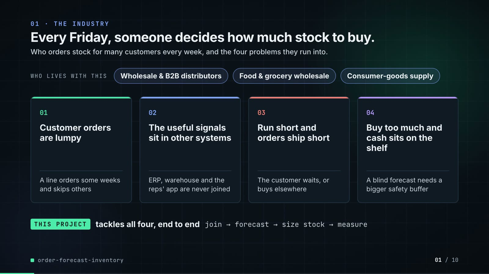

**On-screen text (verbatim)**

> 01 · THE INDUSTRY  
> Every Friday, someone decides how much stock to buy.  
> Who orders stock for many customers every week, and the four problems they run into.  
> WHO LIVES WITH THIS · Wholesale & B2B distributors · Food & grocery wholesale · Consumer-goods supply  
> 01 Customer orders are lumpy — A line orders some weeks and skips others  
> 02 The useful signals sit in other systems — ERP, warehouse and the reps' app are never joined  
> 03 Run short and orders ship short — The customer waits, or buys elsewhere  
> 04 Buy too much and cash sits on the shelf — A blind forecast needs a bigger safety buffer  
> THIS PROJECT tackles all four, end to end · join → forecast → size stock → measure  

**Figures on this slide**

| ID | Shown | Source · key | Calculation | Check |
|---|---|---|---|---|
| F-01 | 3 industry chips | `author's framing` · - | - | manual |
| F-02 | 4 problem cards | `README 'The problem' and 'Why it is hard'` · README lines 13-35 | - | ✓ |

**Assumptions:** A-10

**Illustrative, not data:**

- The whole slide is context; no repo figures.

**To change this slide:** Edit the chips (#ctx-c1..3) and cards (#ctx-k1..4) in compositions/s01-context.html. (project folder `docs/demo/source`).

### Slide 02: This project  
*6.8-11.6 s · composition `compositions/s02-hook.html`*

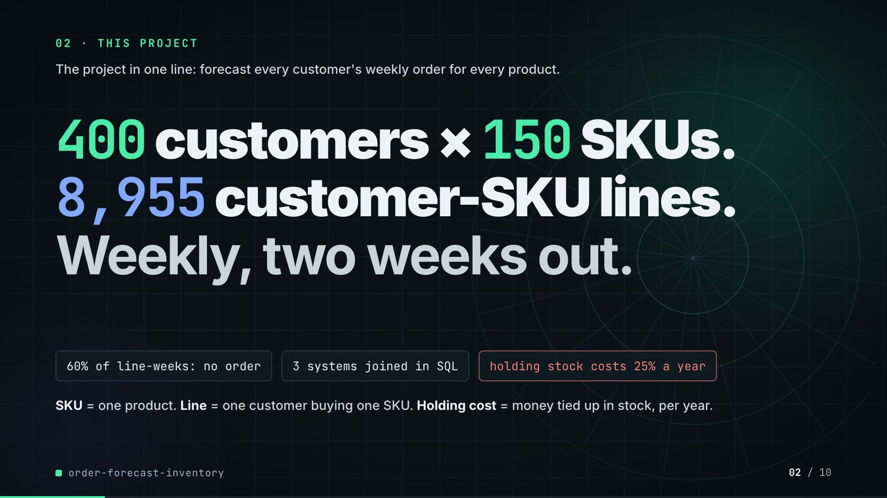

**On-screen text (verbatim)**

> 02 · THIS PROJECT  
> The project in one line: forecast every customer's weekly order for every product.  
> 400 customers × 150 SKUs. 8,955 customer-SKU lines. Weekly, two weeks out.  
> 60% of line-weeks: no order · 3 systems joined in SQL · holding stock costs 25% a year  
> SKU = one product. Line = one customer buying one SKU. Holding cost = money tied up in stock, per year.  

**Figures on this slide**

| ID | Shown | Source · key | Calculation | Check |
|---|---|---|---|---|
| F-03 | 400 customers x 150 SKUs | `outputs/metrics.json; data/raw/customers.parquet, skus.parquet` · scale.customers, scale.skus | - | ✓ |
| F-04 | 8,955 customer-SKU lines | `outputs/metrics.json; recomputed from data/raw/sales_orders.parquet` · source_counts.pairs | distinct (customer, SKU) over non-cancelled order lines | ✓ |
| F-05 | Weekly, two weeks out | `src/order_forecast/config.py:25` · HORIZONS = (1, 2) | - | ✓ |
| F-06 | 60% of line-weeks: no order | `outputs/data_profile.json; recomputed from data/raw/sales_orders.parquet` · share_zero_line_weeks = 0.5966 | 1 - (line-weeks with an order / panel rows) = 0.5966, shown as 60% | ✓ |
| F-07 | 3 systems joined in SQL · holding stock costs 25% a year | `src/order_forecast/pipeline.py:12 (RAW_TABLES); config.py:32` · sales_orders, shipments, field_app_events; ANNUAL_HOLDING_RATE = 0.25 | - | ✓ |

**Assumptions:** A-01, A-03

**Illustrative, not data:**

- Rings in the background are decoration.

**To change this slide:** Headline spans #hook-l1..l3 and chips #hook-f1..f3 in compositions/s02-hook.html; scale comes from config.py FULL. (project folder `docs/demo/source`).

### Slide 03: How it works (white chapter, slide A)  
*11.3-19.3 s · composition `compositions/explainer.html (CONFIG.blocks, CONFIG.groups, CONFIG.loop)`*

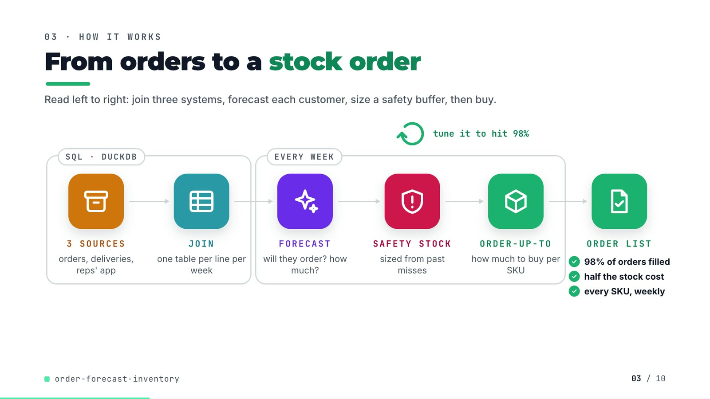

**On-screen text (verbatim)**

> 03 · HOW IT WORKS  
> From orders to a stock order  
> Read left to right: join three systems, forecast each customer, size a safety buffer, then buy.  
> [SQL · DUCKDB: 3 SOURCES orders, deliveries, reps' app → JOIN one table per line per week] → [EVERY WEEK: FORECAST will they order? how much? → SAFETY STOCK sized from past misses → ORDER-UP-TO how much to buy per SKU] → ORDER LIST ✓ 98% of orders filled ✓ half the stock cost ✓ every SKU, weekly  
> tune it to hit 98% (loop over safety stock)  

**Figures on this slide**

| ID | Shown | Source · key | Calculation | Check |
|---|---|---|---|---|
| F-08 | 3 SOURCES → JOIN → FORECAST → SAFETY STOCK → ORDER-UP-TO → ORDER LIST | `src/order_forecast/` · sql/*.sql, models.py, inventory.py | - | ✓ |
| F-09 | tune it to hit 98% | `src/order_forecast/inventory.py:72-97 (bisection); config.py:34` · z_for_fill_rate, TARGET_FILL_RATE = 0.98 | - | ✓ |
| F-10 | 98% of orders filled | `outputs/inventory.csv` · method=lgbm_two_stage, fill_rate_matched | - | ✓ |
| F-11 | half the stock cost / about half the stock | `outputs/inventory.csv` · holding_cost_matched_fill: lgbm_two_stage 129,047 vs ets 242,371 | 129,047 / 242,371 = 0.532 (about half) | ✓ |
| F-12 | every SKU, weekly | `src/order_forecast/inventory.py:1-8; config.py:31` · weekly review, all SKUs | - | ✓ |

**Assumptions:** A-03, A-04, A-05

**Illustrative, not data:**

- Icons and colours are a visual language, not data.

**To change this slide:** Edit CONFIG in compositions/explainer.html; badge truth comes from inventory.csv (F-10, F-11). (project folder `docs/demo/source`).

### Slide 04: The key idea (white chapter, slide B)  
*19.3-26.3 s · composition `compositions/explainer.html (#ex-b ...)`*

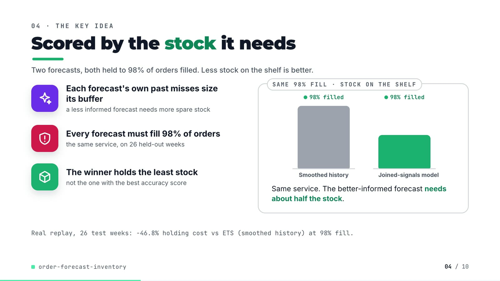

**On-screen text (verbatim)**

> 04 · THE KEY IDEA  
> Scored by the stock it needs  
> Two forecasts, both held to 98% of orders filled. Less stock on the shelf is better.  
> Each forecast's own past misses size its buffer — a less informed forecast needs more spare stock  
> Every forecast must fill 98% of orders — the same service, on 26 held-out weeks  
> The winner holds the least stock — not the one with the best accuracy score  
> SAME 98% FILL · STOCK ON THE SHELF: Smoothed history vs Joined-signals model, both '98% filled'. Same service. The better-informed forecast needs about half the stock.  
> Real replay, 26 test weeks: −46.8% holding cost vs ETS (smoothed history) at 98% fill.  

**Figures on this slide**

| ID | Shown | Source · key | Calculation | Check |
|---|---|---|---|---|
| F-13 | Each forecast's own past misses size its buffer | `src/order_forecast/evaluate.py:205-209` · sigma = RMSE of the forecaster's two-week sum on validation weeks | - | ✓ |
| F-14 | 26 held-out weeks | `outputs/metrics.json` · split.test_weeks | - | ✓ |
| F-15 | two bars | `outputs/inventory.csv avg_inventory_value_matched; compositions/explainer.html` · 969,484 vs 516,188 | 128 = round(240 x 516,188 / 969,484) | ✓ |
| F-16 | −46.8% holding cost vs ETS | `outputs/inventory.csv` · holding_cost_matched_fill | (129,047 - 242,371) / 242,371 x 100 = -46.76% | ✓ |

**Assumptions:** A-03, A-04, A-05, A-06

**Illustrative, not data:**

- 'Smoothed history' = ETS; 'Joined-signals model' = two-stage LightGBM. Bar heights are proportional to average stock value at 98% fill (F-15); the bars carry no numbers on screen.

**To change this slide:** Markup under #ex-b in compositions/explainer.html; footnote figure is F-16. (project folder `docs/demo/source`).

### Slide 05: Architecture  
*26.0-40.8 s · composition `compositions/s03-architecture.html`*

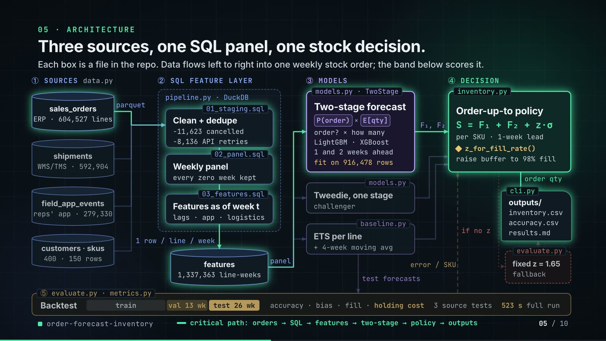

**On-screen text (verbatim)**

> 05 · ARCHITECTURE  
> Three sources, one SQL panel, one stock decision.  
> Each box is a file in the repo. Data flows left to right into one weekly stock order; the band below scores it.  
> ① SOURCES data.py: sales_orders (ERP · 604,527 lines), shipments (WMS/TMS · 592,904), field_app_events (reps' app · 279,330), customers · skus (400 · 150 rows) → parquet  
> ② SQL FEATURE LAYER pipeline.py · DuckDB: 01_staging.sql Clean + dedupe (−11,623 cancelled, −8,136 API retries) → 02_panel.sql Weekly panel (every zero week kept) → 03_features.sql Features as of week t (lags · app · logistics) → 1 row / line / week → features (1,337,363 line-weeks) → panel  
> ③ MODELS: models.py · TwoStage Two-stage forecast P(order) × E[qty], order? × how many, LightGBM · XGBoost, 1 and 2 weeks ahead, fit on 916,478 rows; models.py Tweedie, one stage (challenger); baseline.py ETS per line + 4-week moving avg → F₁, F₂  
> ④ DECISION inventory.py Order-up-to policy S = F₁ + F₂ + z·σ, per SKU · 1-week lead, ◆ z_for_fill_rate(), raise buffer to 98% fill → order qty → cli.py outputs/ (inventory.csv, accuracy.csv, results.md); if no z → evaluate.py fixed z = 1.65 (fallback)  
> ⑤ evaluate.py · metrics.py Backtest: train | val 13 wk | test 26 wk · accuracy · bias · fill · holding cost · 3 source tests · 523 s full run; test forecasts in, error / SKU fed back to the policy  
> Legend: data · models · decision · evaluation · batch hand-off · feedback · fallback; then 'critical path: orders → SQL → features → two-stage → policy → outputs'  

**Figures on this slide**

| ID | Shown | Source · key | Calculation | Check |
|---|---|---|---|---|
| F-03 | 400 customers x 150 SKUs | `outputs/metrics.json; data/raw/customers.parquet, skus.parquet` · scale.customers, scale.skus | - | ✓ |
| F-18 | 604,527 lines · 592,904 · 279,330 | `outputs/metrics.json source_counts` · raw_order_lines, shipments, raw_app_events | - | ✓ |
| F-19 | −11,623 cancelled lines | `outputs/metrics.json; data/raw/sales_orders.parquet status` · raw_order_lines - clean_order_lines | 604,527 - 592,904 = 11,623 (all status = cancelled) | ✓ |
| F-20 | −8,136 API retries | `outputs/metrics.json` · raw_app_events - dedup_app_events | 279,330 - 271,194 = 8,136 | ✓ |
| F-21 | 1,337,363 line-weeks | `outputs/metrics.json; recomputed from data/raw/sales_orders.parquet` · source_counts.panel_rows | - | ✓ |
| F-22 | fit on 916,478 rows | `outputs/run_log.txt` · 'h=1 lgbm_two_stage fitted on 916,478 rows' | - | ✓ |
| F-23 | data.py, pipeline.py, 01/02/03 *.sql, models.py TwoStage + Tweedie, baseline.py, inventory.py z_for_fill_rate(), cli.py outputs, evaluate.py, metrics.py | `src/order_forecast/` · files + functions | - | ✓ |
| F-24 | z = NaN → fixed z = 1.65 fallback | `src/order_forecast/evaluate.py:220; inventory.py:85-86; config.py:33` · np.isfinite(z_star) else fixed | - | ✓ |
| F-25 | val 13 wk · test 26 wk · 523 s full run | `config.py:22-23; outputs/metrics.json runtime_seconds` · VAL_WEEKS, TEST_WEEKS, 522.6 s | 522.6 rounded | ✓ |
| F-26 | ablation ×3 | `outputs/ablation.csv; evaluate.py:40-45` · 3 ablations + the full model | rows - 1 | ✓ |
| F-27 | 1-wk lead · 98% fill · horizons 1 and 2 | `src/order_forecast/config.py:25-34` · LEAD_TIME_WEEKS = 1; TARGET_FILL_RATE = 0.98 | - | ✓ |

- *F-24 note:* Not taken in the published run: every forecaster's z was found (inventory.csv fill_rate_matched = 0.98 for all).

**Assumptions:** A-01, A-04, A-05, A-06

**Illustrative, not data:**

- Packets moving along the wires show execution order, not data volume.
- The critical path is the chain that produces the deciding number (inventory.csv); it is a reading of cli.py's call order, not a measured latency.
- There is no human-in-the-loop step and no online serving in the repo; outputs are batch files.

**To change this slide:** Nodes are built from the add()/cyl() calls and the wires array in compositions/s03-architecture.html. (project folder `docs/demo/source`).

### Slide 06: The system running  
*40.4-55.0 s · composition `compositions/s04-routes.html (TRACE block injected by tools/inject_sheet.py)`*

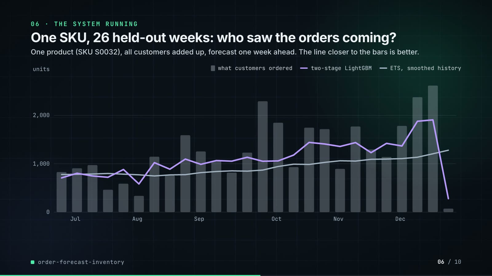

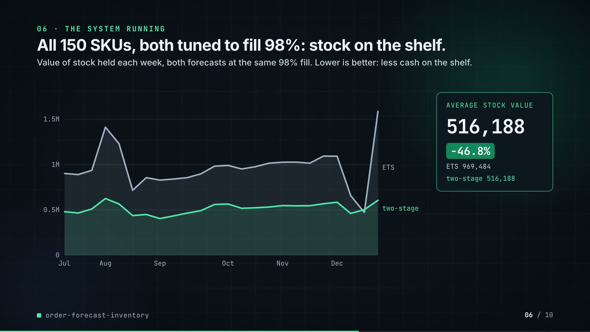

**On-screen text (verbatim)**

> 06 · THE SYSTEM RUNNING  
> One SKU, 26 held-out weeks: who saw the orders coming? · One product (SKU S0032), all customers added up, forecast one week ahead. The line closer to the bars is better. · bars = what customers ordered, lines = two-stage LightGBM, ETS  
> All 150 SKUs, both tuned to fill 98%: stock on the shelf. · Value of stock held each week, both forecasts at the same 98% fill. Lower is better: less cash on the shelf.  
> AVERAGE STOCK VALUE 969,484 → 516,188 · −46.8% · ETS 969,484 · two-stage 516,188  

**Figures on this slide**

| ID | Shown | Source · key | Calculation | Check |
|---|---|---|---|---|
| F-28 | SKU S0032 chart (26 bars, 2 lines) | `demo assets/order_list.json trace (re-run of make run; S0032 = 20th SKU by test-window demand)` · trace.demand, forecast_h1_lgbm, forecast_h1_ets | line forecasts summed to SKU, origin = week before | ✓ |
| F-29 | ETS 969,484 | `outputs/inventory.csv` · method=ets, avg_inventory_value_matched | - | ✓ |
| F-30 | two-stage 516,188 | `outputs/inventory.csv` · method=lgbm_two_stage, avg_inventory_value_matched | - | ✓ |
| F-31 | −46.8% | `outputs/inventory.csv` · F-30 vs F-29 | (516,188 - 969,484) / 969,484 x 100 = -46.76% | ✓ |
| F-32 | two weekly lines, Jul-Dec | `demo assets/order_list.json stock_value_weekly` · mean of weeks 3-26 (after the 2 warm-up weeks) | mean = avg_inventory_value_matched | ✓ |

**Assumptions:** A-04, A-05, A-06, A-07, A-08

**Illustrative, not data:**

- The repo saves no plots; both charts are drawn from the exported JSON (real values, not redrawn by hand).

**To change this slide:** Re-run tools/export_order_list.py (TRACE_SKU_RANK picks the SKU) and tools/inject_sheet.py; layout in compositions/s04-routes.html. (project folder `docs/demo/source`).

### Slide 07: End-user value (white)  
*54.7-67.7 s · composition `compositions/value.html (SHEET block injected by tools/inject_sheet.py)`*

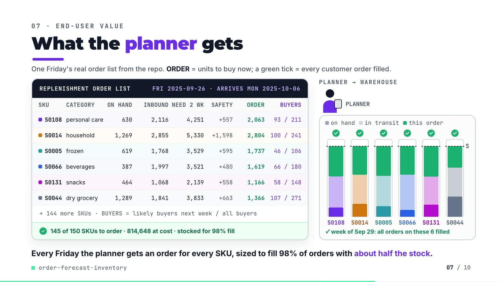

**On-screen text (verbatim)**

> 07 · END-USER VALUE  
> What the planner gets  
> One Friday's real order list from the repo. ORDER = units to buy now; a green tick = every customer order filled.  
> REPLENISHMENT ORDER LIST · FRI 2025-09-26 · ARRIVES MON 2025-10-06 — columns SKU, CATEGORY, ON HAND, INBOUND, NEED 2 WK, SAFETY, ORDER, BUYERS  
> S0108 personal care 630 2,116 4,251 +557 2,063 93 / 211  
> S0014 household 1,269 2,855 5,330 +1,598 2,804 100 / 241  
> S0005 frozen 619 1,768 3,529 +595 1,737 46 / 106  
> S0066 beverages 387 1,997 3,521 +480 1,619 66 / 180  
> S0131 snacks 464 1,068 2,139 +558 1,166 58 / 148  
> S0044 dry grocery 1,289 1,841 3,833 +663 1,366 107 / 271  
> + 144 more SKUs · BUYERS = likely buyers next week / all buyers · ✓ 145 of 150 SKUs to order · 814,648 at cost · stocked for 98% fill  
> PLANNER → WAREHOUSE · on hand · in transit · this order · S · arrives Oct 6 · ✓ week of Sep 29: all orders on these 6 filled  
> Every Friday the planner gets an order for every SKU, sized to fill 98% of orders with about half the stock.  

**Figures on this slide**

| ID | Shown | Source · key | Calculation | Check |
|---|---|---|---|---|
| F-11 | half the stock cost / about half the stock | `outputs/inventory.csv` · holding_cost_matched_fill: lgbm_two_stage 129,047 vs ets 242,371 | 129,047 / 242,371 = 0.532 (about half) | ✓ |
| F-33 | FRI 2025-09-26 · ARRIVES MON 2025-10-06 | `demo assets/order_list.json decision` · friday, arrives (test week 13 + 2 weeks lead) | week_start 2025-09-22 + 4 days; arrival = start of week t+2 | ✓ |
| F-34 | S0108, S0014, S0005, S0066, S0131, S0044 | `demo assets/order_list.json, injected into compositions/value.html` · decision.rows | order = need 2 wk + safety - on hand - in transit; buyers = Σ P(order) over the SKU's lines / lines | ✓ |
| F-35 | + 144 more SKUs | `decision.n_skus` · 150 - 6 | 150 - 6 = 144 | ✓ |
| F-36 | 145 of 150 SKUs to order | `demo assets/order_list.json` · decision.n_to_order (order qty > 0.5) | - | ✓ |
| F-37 | 814,648 at cost | `demo assets/order_list.json` · decision.order_value | Σ order qty x unit cost | ✓ |
| F-38 | week of Sep 29: every order on these 6 SKUs filled | `demo assets/order_list.json rows next_week_demand` · demand in week 2025-09-29 <= on hand + in transit | all six rows | ✓ |

**Assumptions:** A-02, A-04, A-05, A-07, A-08

**Illustrative, not data:**

- The planner figure, truck and bins are illustrative; each bin is scaled to its own SKU's order-up-to level S, and the segment heights (on hand, in transit, this order) are real proportions.
- The scene compresses time: the order arrives on Oct 6, while next week's orders (Sep 29) are served from on hand + in transit (F-38).
- 'about half the stock' is the 46.8% holding-cost cut (F-11).

**To change this slide:** Re-run tools/export_order_list.py, then tools/inject_sheet.py (--rows picks the SKUs); layout in compositions/value.html. (project folder `docs/demo/source`).

### Slide 08: Results  
*67.4-76.2 s · composition `compositions/s05-results.html (stats array)`*

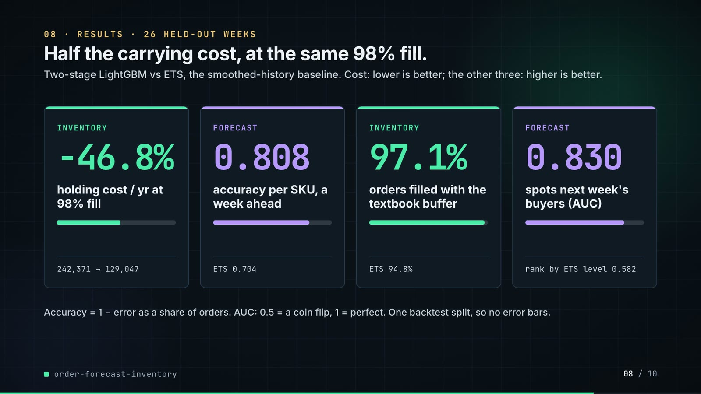

**On-screen text (verbatim)**

> 08 · RESULTS · 26 HELD-OUT WEEKS  
> Half the carrying cost, at the same 98% fill.  
> Two-stage LightGBM vs ETS, the smoothed-history baseline. Cost: lower is better; the other three: higher is better.  
> INVENTORY −46.8% holding cost / yr at 98% fill · 242,371 → 129,047  
> FORECAST 0.808 accuracy per SKU, a week ahead · ETS 0.704  
> INVENTORY 97.1% orders filled with the textbook buffer (z = 1.65) · ETS 94.8%  
> FORECAST 0.830 spots next week's buyers (AUC) · rank by ETS level 0.582  
> Accuracy = 1 − error as a share of orders. AUC: 0.5 = a coin flip, 1 = perfect. One backtest split, so no error bars.  

**Figures on this slide**

| ID | Shown | Source · key | Calculation | Check |
|---|---|---|---|---|
| F-03 | 400 customers x 150 SKUs | `outputs/metrics.json; data/raw/customers.parquet, skus.parquet` · scale.customers, scale.skus | - | ✓ |
| F-14 | 26 held-out weeks | `outputs/metrics.json` · split.test_weeks | - | ✓ |
| F-39 | 242,371 → 129,047 | `outputs/inventory.csv` · holding_cost_matched_fill | - | ✓ |
| F-40 | −46.8% | `outputs/inventory.csv` · F-39 | (129,047 - 242,371) / 242,371 x 100 = -46.76% | ✓ |
| F-41 | 0.808 · ETS 0.704 | `outputs/accuracy.csv` · horizon=1, accuracy_sku | - | ✓ |
| F-42 | 97.1% · ETS 94.8% | `outputs/inventory.csv` · fill_rate_fixed_z | x 100 | ✓ |
| F-43 | 0.830 · 0.582 | `outputs/order_auc.csv` · scorer rows | - | ✓ |

**Assumptions:** A-03, A-04, A-05, A-06, A-07, A-09

**Illustrative, not data:**

- Mini bars: card 1 = after / before; cards 2-4 = the value on a 0-1 scale, growing from the ETS value.

**To change this slide:** The stats array and card text in compositions/s05-results.html. (project folder `docs/demo/source`).

### Slide 09: Lesson and fix  
*75.8-84.8 s · composition `compositions/s06-twist.html`*

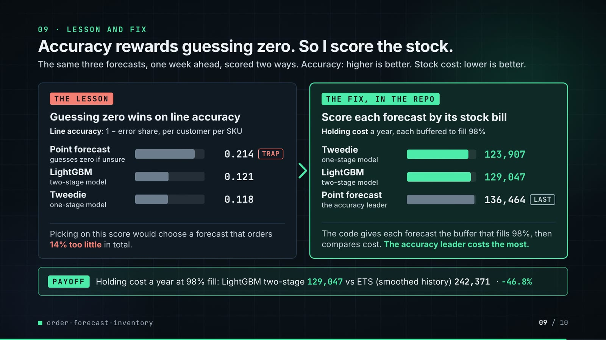

**On-screen text (verbatim)**

> 09 · LESSON AND FIX  
> Accuracy rewards guessing zero. So I score the stock.  
> The same three forecasts, one week ahead, scored two ways. Accuracy: higher is better. Stock cost: lower is better.  
> THE LESSON · Guessing zero wins on line accuracy · Line accuracy: 1 − error share, per customer per SKU · Point forecast (guesses zero if unsure) 0.214 TRAP · LightGBM (two-stage model) 0.121 · Tweedie (one-stage model) 0.118 · Picking on this score would choose a forecast that orders 14% too little in total.  
> THE FIX, IN THE REPO · Score each forecast by its stock bill · Holding cost a year, each buffered to fill 98% · Tweedie (one-stage model) 123,907 · LightGBM (two-stage model) 129,047 · Point forecast (the accuracy leader) 136,464 LAST · The code gives each forecast the buffer that fills 98%, then compares cost. The accuracy leader costs the most.  
> PAYOFF · Holding cost a year at 98% fill: LightGBM two-stage 129,047 vs ETS (smoothed history) 242,371 · −46.8%  

**Figures on this slide**

| ID | Shown | Source · key | Calculation | Check |
|---|---|---|---|---|
| F-17 | The accuracy leader costs the most. | `outputs/accuracy.csv (h=1 accuracy_pair); outputs/inventory.csv` · lgbm_point has max accuracy_pair and higher holding cost than the other boosted models | argmax accuracy = lgbm_point; its holding cost > each of the other three boosted models | ✓ |
| F-44 | 123,907 · 129,047 · 136,464 | `outputs/inventory.csv` · holding_cost_matched_fill | - | ✓ |
| F-45 | 0.214 · 0.121 · 0.118 | `outputs/accuracy.csv` · horizon=1, accuracy_pair | - | ✓ |
| F-46 | 189 / 106 / 104 px · 195 / 203 / 214 px | `compositions/s06-twist.html` · inline widths | round(acc x 880); round(cost x 220 / 140,000) | ✓ |
| F-47 | orders 14% too little in total | `outputs/accuracy.csv` · horizon=1, method=lgbm_point, bias_pair = -0.1406 | bias = (sum forecast - sum actual) / sum actual (metrics.bias); -0.1406 shown as 14% too little | ✓ |
| F-51 | The code gives each forecast the buffer that fills 98%, then compares cost. | `src/order_forecast/inventory.py (z_for_fill_rate); src/order_forecast/evaluate.py (inventory_table, holding_cost_matched_fill); config.py TARGET_FILL_RATE; tests/test_inventory.py::test_matched_z_reaches_the_target_fill_rate; docs/adr/0001` · - | - | ✓ |
| F-52 | 129,047 vs ETS (smoothed history) 242,371 · −46.8% | `outputs/inventory.csv` · holding_cost_matched_fill | (129,047 - 242,371) / 242,371 x 100 = -46.76% | ✓ |

**Assumptions:** A-03, A-04, A-05, A-06, A-07, A-09

**Illustrative, not data:**

- Bars: grey = options being compared, mint = the forecasts the stock score keeps; coral only on the TRAP label. Each panel has its own scale because the units differ (F-46).
- The 'point' forecast is the repo's diagnostic variant (zero unless P(order) >= 0.5, evaluate.py), kept to show what line accuracy rewards; 'guesses zero if unsure' is a plain reading of that rule.

**To change this slide:** Panels #twist-left / #twist-right and the payoff strip in compositions/s06-twist.html; bar widths are inline styles (F-46). (project folder `docs/demo/source`).

### Slide 10: End card  
*84.4-88.8 s · composition `compositions/s07-end.html`*

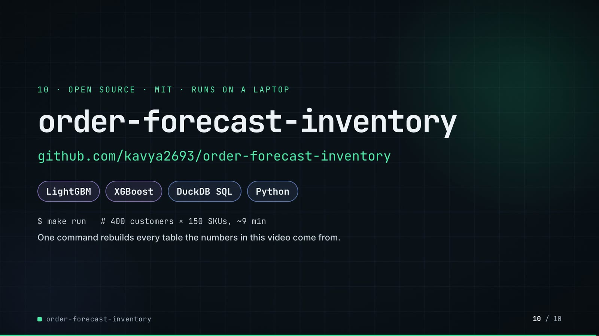

**On-screen text (verbatim)**

> 10 · OPEN SOURCE · MIT · RUNS ON A LAPTOP  
> order-forecast-inventory  
> github.com/kavya2693/order-forecast-inventory  
> LightGBM · XGBoost · DuckDB SQL · Python  
> $ make run   # 400 customers × 150 SKUs, ~9 min  
> One command rebuilds every table the numbers in this video come from.  

**Figures on this slide**

| ID | Shown | Source · key | Calculation | Check |
|---|---|---|---|---|
| F-48 | MIT | `LICENSE line 1` · - | - | ✓ |
| F-49 | LightGBM · XGBoost · DuckDB SQL · Python | `pyproject.toml dependencies` · lightgbm, xgboost, duckdb | - | ✓ |
| F-50 | $ make run # 400 customers × 150 SKUs, ~9 min | `Makefile; outputs/metrics.json runtime_seconds` · 522.6 s | 522.6 / 60 = 8.7 min | ✓ |

**Assumptions:** A-09

**To change this slide:** Text in compositions/s07-end.html. (project folder `docs/demo/source`).

## 5. Change-impact matrix

| Input / assumption | Affected figures | Affected slides | Files to edit | Commands to re-run |
|---|---|---|---|---|
| A-01: All data is synthetic, produced by a seeded generator sized to the production problem (400 customers, 150 SKUs, 156 weeks, five source tables) | all figures | 01, 02, 03, 04, 05, 06, 07, 08, 09, 10 | `src/order_forecast/config.py (Scale); src/order_forecast/data.py` | `make run` |
| A-02: The field-app lift is a property of the generator: a quote request precedes an order with a probability chosen in data | F-24, F-25, F-31, F-32, F-33, F-34, F-36, F-37, F-38, F-41, F-42 | 05, 06, 07, 08 | `src/order_forecast/data.py:169` | `make run; export_order_list.py + inject_sheet.py` |
| A-03: Carrying stock costs 25% of its value a year; holding cost = weekly stock value x 0 | F-07, F-15, F-31, F-36, F-37, F-38, F-41, F-42, F-43, F-44, F-45 | 02, 04, 06, 07, 08, 09 | `src/order_forecast/config.py:32` | `make run` |
| A-04: Inventory policy: weekly order-up-to S = F(t+1) + F(t+2) + z x sigma per SKU, one week lead time (an order placed at the end of week t arrives at the start of week t+2), lost sales, two warm-up weeks not scored, no case packs, minimums or capacity | F-12, F-13, F-15, F-27, F-31, F-33, F-34, F-36, F-37, F-38, F-39, F-40, F-41, F-42, F-43 | 03, 04, 05, 06, 07, 08 | `src/order_forecast/config.py:26-35; src/order_forecast/inventory.py` | `make run; export_order_list.py + inject_sheet.py` |
| A-05: Safety stock sigma for each forecaster is the RMSE of its own two-week SKU forecast over the 13 validation weeks; z is found by bisection so the test weeks reach 98% fill | F-12, F-13, F-14, F-15, F-28, F-31, F-36, F-37, F-38, F-41, F-42, F-43, F-44, F-45 | 03, 04, 06, 07, 08, 09 | `src/order_forecast/config.py:23 (VAL_WEEKS), :34 (TARGET_FILL_RATE)` | `make run; export_order_list.py + inject_sheet.py` |
| A-06: One backtest split: train on weeks before 2025-03-31, 13 validation weeks, 26 test weeks from 2025-06-30 | F-14, F-27, F-28, F-36, F-37, F-38, F-39, F-40, F-41, F-42, F-43, F-44, F-45, F-46, F-47 | 04, 05, 06, 07, 08, 09 | `src/order_forecast/config.py:22-23` | `make run` |
| A-07: Unit costs are generated per SKU, so all money figures are in the generator's currency units, not a real currency | F-31, F-36, F-37, F-38, F-41, F-42, F-44, F-45 | 06, 07, 08, 09 | `src/order_forecast/data.py (SKU unit_cost)` | `make run` |
| A-08: The order list on slide 07 is the LightGBM two-stage policy's decision at the end of test week 13 (Friday 2025-09-26) | F-33, F-34, F-35, F-36, F-37, F-38 | 07 | `tools/export_order_list.py (DECISION_WEEK, TRACE_SKU_RANK); inject_sheet.py --rows` | `export_order_list.py + inject_sheet.py; hyperframes render` |
| A-09: Video rounding: money and counts to whole numbers with thousands separators, accuracy and AUC to 3 decimals, percentages to 1 decimal; '~9 min' and '523 s' are rounded run times | F-21, F-29, F-30, F-31, F-35, F-39, F-40, F-41, F-42, F-43, F-44, F-45, F-46, F-47, F-50 | 05, 06, 07, 08, 09, 10 | `the composition file named on each slide` | `hyperframes render` |
| A-10: Slide 01 (industries, everyday problems) is general distribution knowledge used as context | F-01, F-02 | 01 | `compositions/s01-context.html` | `hyperframes render` |

## 6. Known differences and caveats

- The field-app lift, and with it most of the holding-cost gap, is a property of the seeded generator (A-02). How much a real rep's quote log predicts real orders must be measured on real data (README 'Known limitations', biggest gap).
- One backtest split (A-06): the three boosted mean forecasts land within about 4% of each other on holding cost, which a second split could reorder.
- Line-level accuracy is low for every method (0.12 at one week, negative at two weeks); the result rests on summing to SKU level (README 'The result' point 1).
- Slide 07's order list is a re-run of make run's code for two forecasters (A-08); the export asserts its inventory numbers equal outputs/inventory.csv before writing.
- Money figures are in generated currency units (A-07).
- Slide 09 no longer shows that the two-stage split only ties a single-stage Tweedie model (123,907 vs 129,047 a year at 98% fill; XGBoost two-stage 124,338), nor that it is kept because P(order) is a number a rep can act on. README 'At a glance' (What didn't win) and 'The result' still report both.
- Slide 09 marks no single model PICKED: the three boosted mean forecasts tie within about 4% on holding cost (one split), so the right panel shows the two shown boosted rows in mint and the accuracy leader last. The repo's deciding number (holding cost at matched fill) is what rejects the point forecast.
- Slide 01 statements are general industry knowledge (A-10).
- The repo has no online serving, latency target or human approval step; the architecture shows a batch backtest with file outputs.

## Appendix: environment

- Commit: `7b2e475645cf52bef902c8ef2d00e693571debab`
- Python: 3.11.7
- lightgbm 4.7.0
- xgboost 3.2.0
- duckdb 1.5.6
- pandas 3.0.6
- numpy 2.4.6
- sklearn 1.9.1
- Profile / seeds: scale=FULL, seed=7, model_random_state=0
- Run time: metrics.json runtime_seconds = 522.6 s (about 8.7 min) for make run on the author's laptop, ORDER_FORECAST_THREADS=1
